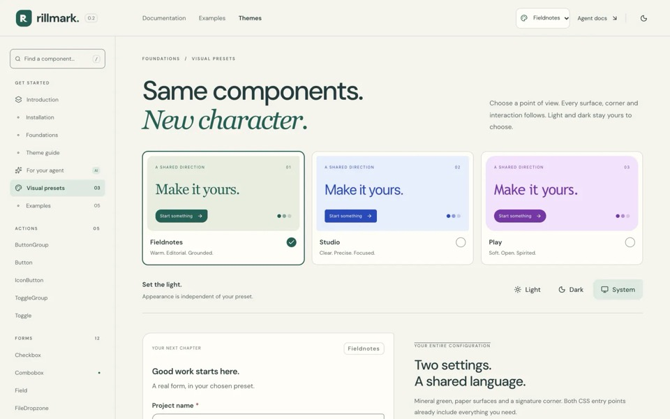
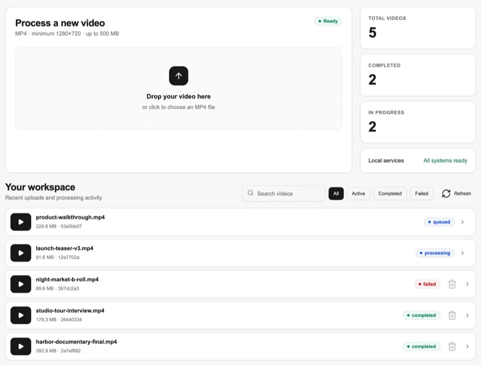
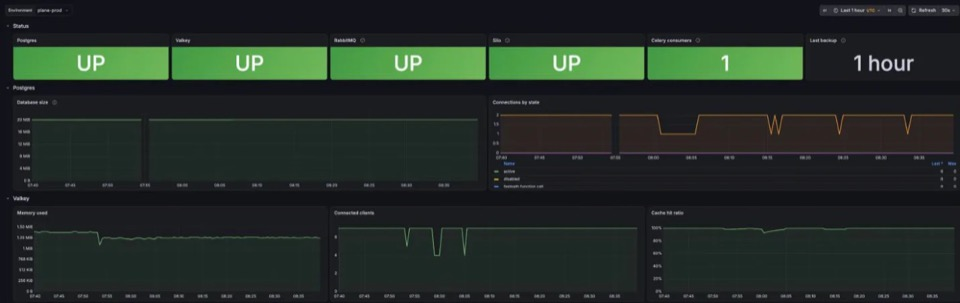
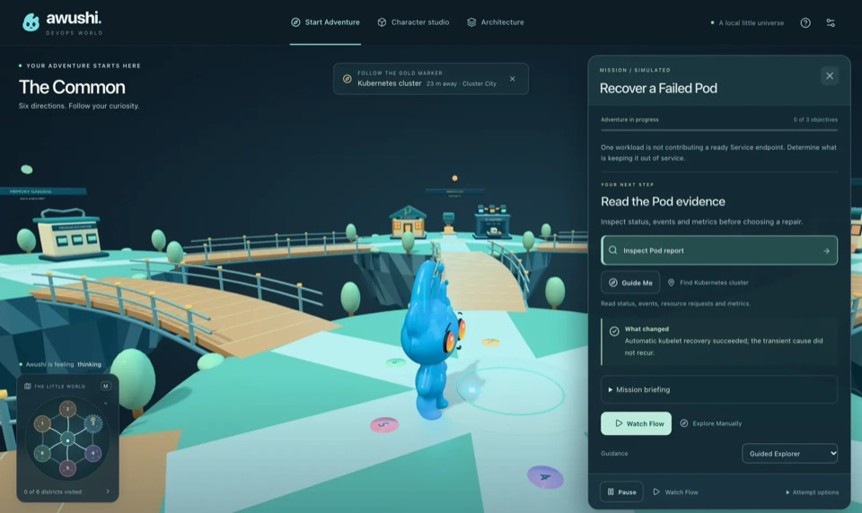

# Bereket Abera

I build complex product interfaces and carry them through to production. Eight-plus years on the web, deepest in Vue and Nuxt.

At [Acelab](https://bereket.dev/work/acelab) I work on a large Vue and Nuxt product for architects and manufacturers, and since June 2026 on the .NET endpoints and SQL behind my features.

## Personal projects

The project pages on bereket.dev say what is mine and what came from elsewhere.

### [Rillmark](https://bereket.dev/work/rillmark)

A React component library on npm, with 26 of its 48 components importing Radix primitives, and three visual presets.

### [Frameflow](https://bereket.dev/work/frameflow)

A video processing pipeline, from upload to private adaptive stream.

Local preview with sample records.

### [Wayline](https://bereket.dev/work/wayline)

A self-hosted deployment of Plane, the open-source project tracker, on Kubernetes with GitOps, CI/CD, secrets, monitoring and backups around it.

### [Awushi Cloudgarden](https://bereket.dev/#projects)

A small 3D browser game that teaches DevOps through simulated lessons.

## Contact

Open to senior roles and contract work, remote from Addis Ababa (UTC+3).

[bereket.dev](https://bereket.dev) | [LinkedIn](https://www.linkedin.com/in/bereket-abera-629380180/) | bereket5042@gmail.com
